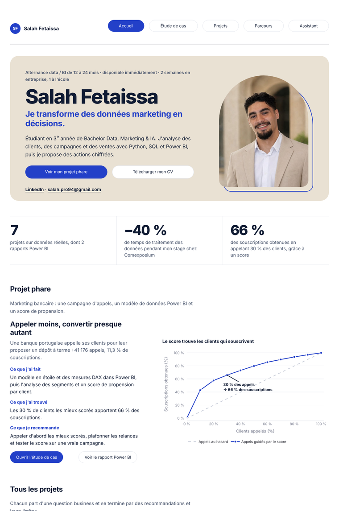

# Portfolio Data & Marketing · Salah Fetaissa

**Étudiant en 3ᵉ année de Bachelor Ingénierie Data, Marketing & IA à Efrei Paris.**
Je cherche une alternance de 12 à 24 mois en data analyse, BI ou marketing data (2 semaines en entreprise, 1 semaine à l'école), disponible immédiatement.

**Voir le site : [salah-fetaissa.streamlit.app](https://salah-fetaissa.streamlit.app/)**
· [LinkedIn](https://www.linkedin.com/in/salah-fetaissa-3b505b292/) · salah.pro94@gmail.com



## Ce que contient le site

| Page | Contenu |
| --- | --- |
| Accueil | Profil, trois résultats chiffrés, projet phare et liste des projets |
| Étude de cas | Parcours guidé en trois étapes sur deux jeux de données : indicateurs avec filtres, analyse de marché, recommandations et simulateurs |
| Projets | Neuf projets sur données réelles, chacun de la question business jusqu'aux limites de l'analyse |
| Parcours | CV téléchargeable, expériences, formation détaillée, compétences |
| Assistant | Chatbot qui répond aux questions sur mon profil et mes projets à partir du contenu du site, en citant ses sources |

## Projets

| # | Projet | Outils | Résultat principal |
| --- | --- | --- | --- |
| 1 | Livraison et satisfaction client (Olist) | Python, pandas | Une commande en retard est notée 2,3 sur 5, contre 4,3 à l'heure |
| 2 | Segmentation clients RFM (Online Retail) | Python, pandas | 75 % du chiffre d'affaires vient de 20 % des clients |
| 3 | Réponse aux campagnes marketing | Python, pandas, scoring | Les 30 % de clients les mieux ciblés regroupent 62 % des répondants |
| 4 | Prévision des ventes (Favorita) | Python, séries temporelles | Une prévision simple à 7,5 % d'erreur, référence à battre |
| 5 | Entonnoir de leads (Olist) | Python, analyse de conversion | La recherche payante convertit 12,3 % des leads, l'email 3,0 % |
| 6 | Churn télécom | Power BI, DAX, modèle en étoile | 28 % des clients concentrent 55 % des résiliations |
| 7 | Marketing bancaire (projet phare) | Power BI, DAX, score de propension | 30 % des appels, les mieux scorés, captent 66 % des souscriptions |
| 8 | Géomarketing : où ouvrir un commerce à Paris ? | Python, géodonnées, open data | Score d'attractivité de 992 quartiers à partir de 60 439 commerces, du recensement et des validations en gare |
| 9 | Parcours d'achat e-commerce en SQL (Google Analytics 4) | SQL, BigQuery, GA4 | 77 % des visiteurs ne regardent aucun produit ; une fois le panier rempli, 35 % achètent |

## Comment fonctionne l'assistant

1. La question du visiteur est comparée aux passages du site (CV, projets, analyses, recommandations) pour retrouver les plus proches.
2. Ces passages sont envoyés à un modèle de langage (via l'API Groq) avec des consignes : répondre uniquement à partir de ce contenu, citer les sources, dire quand il ne sait pas.
3. Sans clé d'API, l'assistant affiche directement les passages retrouvés.

Les prompts du projet suivent la structure *Task → Context files → References → Success brief → Rules → Conversation → Plan → Alignment* : ils sont visibles sur le site, page Assistant › Méthode et prompts.

## Lancer le site en local

```bash
pip install -r requirements.txt
streamlit run app_v2.py
```

Pour activer l'assistant, créer `.streamlit/secrets.toml` (jamais publié) :

```toml
LLM_PROVIDER = "groq"
LLM_API_KEY  = "votre-clé"
LLM_MODEL    = "openai/gpt-oss-120b"
```

## Organisation du dépôt

| Fichier | Rôle |
| --- | --- |
| `app_v2.py` | Version actuelle du site (navigation en 5 entrées) |
| `app_portfolio.py` | Première version du site, rendue pour le projet de cours |
| `prepare_data.py` | Préparation des données des projets 1 à 5 |
| `data/ga4_requetes.sql` | Les 5 requêtes SQL du projet 9, exécutées dans BigQuery |
| `prepare_geomarketing.py` | Préparation des données du projet 8 (à lancer en local, avec shapely et pyproj) |
| `data/` | Données nettoyées (CSV) |
| `assets/` | Photo et CV en PDF |

## Données

Olist (Kaggle), Online Retail et Bank Marketing (UCI), Customer Personality Analysis (Kaggle), Favorita (Kaggle), IBM Telco Customer Churn ; pour le projet 9 : export GA4 de la Google Merchandise Store (BigQuery, données publiques de Google) ; pour le projet 8 : Apur (BDCOM 2023, IRIS), Insee (recensement et Filosofi 2021), Île-de-France Mobilités (validations et gares). Données publiques, utilisées à des fins de démonstration.

Python · pandas · NumPy · Plotly · Streamlit · SQL · BigQuery · Power BI · DAX · LLM
